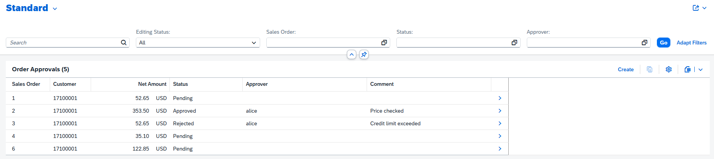
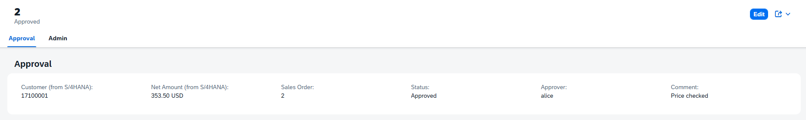
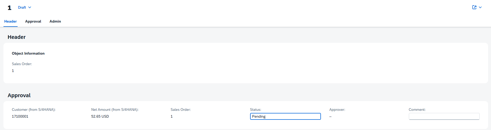

# Sales Order Cockpit — SAP BTP side-by-side extension

A small approval app for **S/4HANA sales orders**, built with the **SAP Cloud Application Programming Model (CAP)** and deployed to **SAP BTP (Cloud Foundry)**.

A sales manager opens one page, sees live sales orders from S/4HANA, and approves or rejects them. S/4HANA itself is never modified (Clean Core): the app **reads** SAP's data live and **stores only its own data** (approval status, approver, comment) in its own SAP HANA Cloud database.



## What it shows

| Area | How it's done |
|---|---|
| Clean Core extension | Separate app on BTP; S/4HANA is read through its public OData API, never changed |
| Live S/4HANA data | `API_SALES_ORDER_SRV` (OData v2), imported with `cds import`, queried with CAP remote services |
| Read vs. store | Customer and net amount are *virtual* fields, filled in at read time from S/4HANA and never copied into our database |
| Efficient calls | One batched S/4HANA request per page (`SalesOrder in (...)`), not one call per row |
| Fiori elements UI | List report + object page driven by CDS annotations, with draft editing |
| Security | XSUAA login; only users with the `Approver` role can create or change approvals |
| Audit-safe approvals | Approver is set from the logged-in user on save and is read-only, so nobody can approve in someone else's name |
| Data quality | Status limited to Pending / Approved / Rejected; sales order number locked after creation |
| Resilience | If S/4HANA is unreachable, approvals still load (without the SAP details) and a warning is logged |
| Money formatting | Net amount annotated with its ISO currency, so it shows as `52.65 USD` |





## Tech stack

SAP CAP (Node.js) · CDS · SAP HANA Cloud · SAP BTP Cloud Foundry · XSUAA · Fiori elements · MTA (`mbt build`, `cf deploy`) · SAP Business Accelerator Hub sandbox API

## Project layout

```
sales-cockpit/
  db/schema.cds              our own data: OrderApprovals
  srv/approval-service.cds   service, role rules, virtual S/4HANA fields
  srv/approval-service.js    reads S/4HANA, merges details, sets approver
  srv/annotations.cds        Fiori elements UI (columns, filters, object page)
  srv/external/              imported S/4HANA Sales Order API model
  mta.yaml, xs-security.json BTP deployment and roles
bookshop/                    SAP's CAP sample, used for learning
```

## Run it locally

Needs Node.js and `@sap/cds-dk`, plus a free API key from the SAP Business Accelerator Hub (api.sap.com).

```
cd sales-cockpit
npm install
$env:SAP_API_KEY="your-key"   # PowerShell
cds watch
```

Open http://localhost:4004 and log in as `alice` (Approver role) or `bob` (read only).

## Notes

- Sales order data comes from SAP's public sandbox, which has only one demo customer (17100001). On a real system it shows real customers.
- Next: Status as a dropdown (value help), and a second app, a Supplier Invoice Checker on the procure-to-pay side.

---
Built by Tehseen Ahmad Waheed (Aruonex) · open to SAP BTP / CAP freelance work
